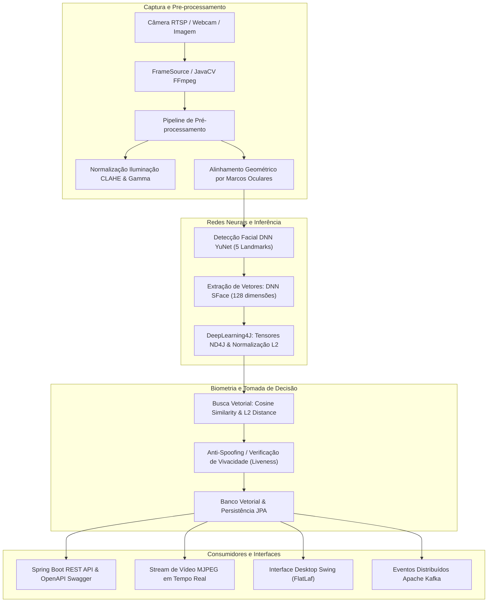

# 🛡️ Plataforma Avançada de Detecção e Reconhecimento Facial em Java

[](https://www.oracle.com/java/technologies/downloads/#java21)
[](https://spring.io/projects/spring-boot)
[](https://opencv.org/)
[](https://deeplearning4j.konduit.ai/)
[](LICENSE)

Sistema corporativo de alto desempenho para **visão computacional**, **inteligência artificial** e **biometria facial** desenvolvido em **Java 21 LTS**, integrando redes neurais profundas pré-treinadas (**DNN YuNet** e **DNN SFace**), computação tensorial com **DeepLearning4J (ND4J)**, microsserviço REST com **Spring Boot 3**, mensageria com **Apache Kafka** e interface gráfica moderna para monitoramento em tempo real com **Java Swing (FlatLaf)**.

---

## 🏛️ Arquitetura da Solução

O projeto segue os princípios de *Clean Architecture* e arquitetura modular Maven independente:

```
facial-recognition-platform/
├── facial-core/          # Visão computacional, captura de frames, pré-processamento (CLAHE/Gamma),
│                         # DNN YuNet (5 marcos), DNN SFace (128-d), banco vetorial e anti-spoofing
├── facial-dl4j/          # Tensores ND4J acelerados por BLAS e redes neurais MLP para classificação
├── facial-persistence/   # Entidades JPA, repositórios H2/PostgreSQL e persistência de vetores
├── facial-messaging/     # Mensageria Kafka e EventBus assíncrono para telemetria de segurança
├── facial-api/           # Servidor REST Spring Boot 3, OpenAPI/Swagger e Streaming MJPEG ao vivo
├── facial-desktop/       # Interface gráfica Desktop moderna (Swing/FlatLaf) e Comparador 1:1
├── models/               # Modelos neurais ONNX (YuNet, SFace) e classificadores Haar Cascade
├── lib/                  # Bibliotecas nativas C++ e GTK2 para aceleração gráfica no Linux
└── scripts/              # Scripts de inicialização e automação multiplataforma (Linux, Mac, Windows)
```



---

## 🚀 Tecnologias e Modelos de IA

1. **Java 21 LTS**: Recursos modernos como Record Patterns, Sequenced Collections e Virtual Threads.
2. **OpenCV 4.10 & JavaCV 1.5.11**: Bindings nativos de alta performance para captura contínua (`VideoCapture`, `FFmpegFrameGrabber`), conversão de espaços de cor (`BGR2GRAY`, `YCrCb`, `Lab`), equalização adaptativa de contraste (**CLAHE**) e transformações afins.
3. **OpenCV DNN Face Detector (YuNet)**:
   - Rede neural convolucional leve para detecção de rostos sob ângulos extremos e oclusões parciais.
   - Extrai bounding boxes e **5 marcos anatômicos**: Olho Direito, Olho Esquerdo, Ponta do Nariz, Canto Direito da Boca e Canto Esquerdo da Boca.
4. **OpenCV DNN Feature Extractor (SFace)**:
   - Mapeia os marcos alinhados em um **vetor numérico de 128 dimensões** normalizado na hiperesfera unitária ($L_2$).
5. **DeepLearning4J (DL4J) & ND4J**:
   - Computação tensorial acelerada por BLAS para cálculos matriciais de similaridade em lote.
   - Rede neural profunda Multi-Layer Perceptron (MLP) para classificação supervisionada de identidades.
6. **Métricas Biométricas**:
   - **Similaridade de Cosseno**: $\cos(\theta) = \frac{\mathbf{u} \cdot \mathbf{v}}{\|\mathbf{u}\| \|\mathbf{v}\|}$ (Limiar padrão: `0.40`).
   - **Distância Euclidiana ($L_2$)**: $\|\mathbf{u} - \mathbf{v}\|_2$ (Limiar padrão: `1.128`).
7. **Spring Boot 3.3.4**: Arquitetura REST corporativa, Swagger UI OpenAPI 3, suporte a multipart uploads e streaming MJPEG contínuo.
8. **Desktop Swing & FlatLaf**: Interface escura moderna com renderização gráfica em tempo real.

---

## 💻 Instruções de Instalação e Execução Multiplataforma

### 📋 Pré-requisitos Comuns (Todos os Sistemas Operacionais)
- **JDK 21 LTS** instalado (Eclipse Temurin, OpenJDK ou Oracle JDK).
- **Apache Maven 3.9+** instalado e adicionado ao `PATH`.
- **Câmera/Webcam** (opcional, para streaming ao vivo ou interface desktop).

---

### 🐧 1. Linux (Ubuntu / Debian / Fedora / Arch)

#### Instalação das dependências do sistema:
```bash
# Ubuntu / Debian
sudo apt update
sudo apt install -y openjdk-21-jdk maven libgtk2.0-0 v4l-utils

# Fedora
sudo dnf install -y java-21-openjdk-devel maven gtk2

# Arch Linux
sudo pacman -S jdk21-openjdk maven gtk2
```

#### Compilação do Projeto:
```bash
mvn clean install -DskipTests
```

#### Executando a API REST (Spring Boot & Stream MJPEG):
```bash
chmod +x scripts/*.sh
./scripts/start-api.sh
```

#### Executando a Interface Desktop (Swing):
```bash
./scripts/start-desktop.sh
```

---

### 🪟 2. Windows 10 / 11

#### Pré-requisitos no Windows:
1. Instale o [JDK 21 LTS (Temurin)](https://adoptium.net/).
2. Instale o [Apache Maven](https://maven.apache.org/download.cgi) e adicione a pasta `bin` às Variáveis de Ambiente (`PATH`).
3. Instale o [Visual C++ Redistributable 2015-2022 (x64)](https://aka.ms/vs/17/release/vc_redist.x64.exe) (necessário para as DLLs nativas do OpenCV e ND4J).

#### Compilação do Projeto:
No PowerShell ou Command Prompt (CMD):
```powershell
mvn clean install -DskipTests
```

#### Execução via PowerShell:
```powershell
# Iniciar Servidor API REST & Streaming
.\scripts\start-api.ps1

# Iniciar Interface Gráfica Desktop
.\scripts\start-desktop.ps1
```

#### Execução via Prompt de Comando (CMD / .bat):
```cmd
rem Iniciar Servidor API REST
scripts\start-api.bat

rem Iniciar Interface Desktop
scripts\start-desktop.bat
```

---

### 🍎 3. macOS (Apple Silicon M1/M2/M3/M4 & Intel)

#### Instalação via Homebrew:
```bash
brew update
brew install openjdk@21 maven

# Vincular o JDK 21 ao sistema
sudo ln -sfn /opt/homebrew/opt/openjdk@21/libexec/openjdk.jdk /Library/Java/JavaVirtualMachines/openjdk-21.jdk
```

#### Compilação do Projeto:
```bash
mvn clean install -DskipTests
```

#### Executando a API REST:
```bash
chmod +x scripts/*.sh
./scripts/start-api.sh
```

#### Executando a Interface Desktop:
```bash
./scripts/start-desktop.sh
```

> [!NOTE]
> No macOS, ao iniciar a aplicação pela primeira vez com webcam, o sistema solicitará permissão de acesso à câmera para o processo Java / Terminal. Clique em **Permitir**.

---

## 📡 Endpoints da API REST & Exemplos de Uso

Quando a API REST for inicializada, o servidor estará escutando na porta **8080**.

* **Documentação Swagger UI interativa**: [http://localhost:8080/swagger-ui.html](http://localhost:8080/swagger-ui.html)
* **OpenAPI 3 JSON Schema**: [http://localhost:8080/v3/api-docs](http://localhost:8080/v3/api-docs)
* **Streaming de Vídeo MJPEG anotado**: [http://localhost:8080/api/v1/stream/mjpeg](http://localhost:8080/api/v1/stream/mjpeg)
* **Snapshot instantâneo anotado**: [http://localhost:8080/api/v1/stream/snapshot](http://localhost:8080/api/v1/stream/snapshot)

### 1. Detecção Facial e Extração de Marcos Anatômicos
Analisa uma foto enviada, detectando faces, caixas delimitadoras e os 5 marcos anatômicos.

```bash
curl -X POST http://localhost:8080/api/v1/faces/detect \
  -F "file=@/caminho/para/foto.jpg"
```

### 2. Cadastro Biométrico (Enrollment)
Cadastra uma nova face na galeria vetorial com metadados do usuário:

```bash
curl -X POST http://localhost:8080/api/v1/faces/enroll \
  -F "file=@/caminho/para/retrato.jpg" \
  -F "id=USR-101" \
  -F "name=Carlos Silva" \
  -F "documentId=123.456.789-00" \
  -F "role=Engenheiro de IA" \
  -F "department=P&D"
```

### 3. Verificação Biométrica 1:1
Compara a face da foto enviada com o cadastro de uma pessoa específica informada via `subjectId`:

```bash
curl -X POST http://localhost:8080/api/v1/faces/verify \
  -F "file=@/caminho/para/selfie.jpg" \
  -F "subjectId=USR-101" \
  -F "threshold=0.40"
```

### 4. Reconhecimento Biométrico 1:N (Identificação na Galeria)
Busca a face mais próxima em toda a base de dados vetorial cadastrada:

```bash
curl -X POST http://localhost:8080/api/v1/faces/identify \
  -F "file=@/caminho/para/desconhecido.jpg" \
  -F "threshold=0.40"
```

### 5. Listar Perfis e Assinaturas Vetoriais
```bash
curl -X GET http://localhost:8080/api/v1/faces/profiles
```

---

## 🖥️ Recursos da Interface Desktop (Swing FlatLaf)

A interface gráfica de monitoramento desktop oferece:
1. **Feed de Vídeo ao Vivo**: Visualização contínua de câmeras locais ou RTSP com caixas delimitadoras e os 5 marcos anatômicos plotados em ciano.
2. **Tags de Reconhecimento em Tempo Real**: Exibição do nome e confiança (verde para autorizado, vermelho para desconhecido/alerta).
3. **Controle Deslizante de Threshold**: Ajuste dinâmico do limiar de similaridade de cosseno em tempo de execução.
4. **Módulo Anti-Spoofing (Liveness)**: Detecção de ataques de apresentação (fotos estáticas / telas).
5. **Comparador Biométrico 1:1**: Ferramenta integrada para carregar duas imagens estáticas lado a lado e inspecionar a similaridade angular e distância euclidiana entre ambas.
6. **Enrollment Rápido**: Cadastro imediato a partir do clique em um frame do feed.

---

## 🔧 Solução de Problemas Comuns (Troubleshooting)

### Linux: `UnsatisfiedLinkError: libgtk-x11-2.0.so.0`
Certifique-se de exportar a biblioteca nativa ou instalar o pacote GTK2:
```bash
sudo apt install -y libgtk2.0-0
export LD_LIBRARY_PATH="$(pwd)/lib:$LD_LIBRARY_PATH"
```

### Windows: `UnsatisfiedLinkError` ao carregar OpenCV/ND4J
Instale o pacote [Microsoft Visual C++ 2015-2022 Redistributable (x64)](https://aka.ms/vs/17/release/vc_redist.x64.exe) e reinicie o terminal.

### macOS: Permissão de câmera bloqueada
Acesse: **Ajustes do Sistema ➔ Privacidade e Segurança ➔ Câmera** e conceda permissão para o seu aplicativo de terminal (Terminal, iTerm2 ou VS Code).

---

## 📄 Licença

Distribuído sob a licença Apache 2.0. Consulte o arquivo `LICENSE` para mais detalhes.
